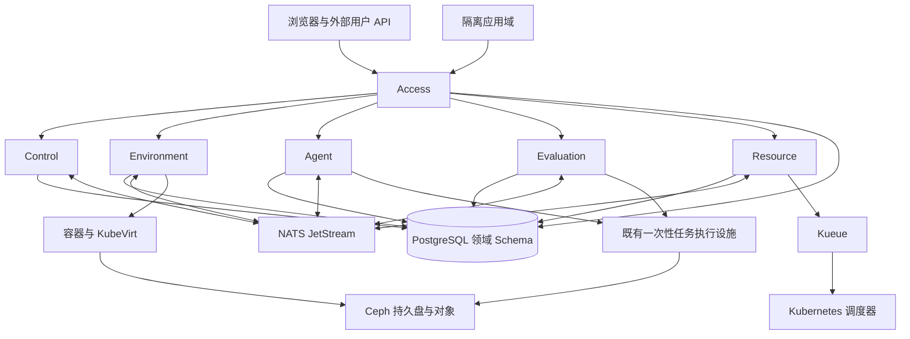

# Sprint5 重构方案

日期：2026-10-12。基线：`develop@7e354381195e9124dd5afd86bd306c6a62fae496`。状态：已完成产品决策和任务拆分，等待逐项实施。

Sprint5 纳入已确认的完整产品目标，分阶段交付，不预设截止日期。本轮只整理方案、调整开发流程文档并建立 GitHub 任务，不修改业务代码，不部署，不清空数据。

入口：[Sprint5 里程碑](https://github.com/TeamMonad/LabWeaver/milestone/6) · [Epic #196](https://github.com/TeamMonad/LabWeaver/issues/196)。细分任务见第 15 节。Issue/PR 保存进度、实际测试结果和未完成事项。本文维护目标、边界和验收规则，不另建状态数据库。

## 1. 输入与结论边界

本方案合并以下仓库材料：

| 输入 | 用途 |
| --- | --- |
| `docs/reviews/2026-10-11-sprint5-product-readiness-review.md` | 27 节产品完整性、架构、运行和异常场景分析 |
| `docs/reviews/2026-10-11-user-experience-review.md` | UX-01 至 UX-24 的用户任务与交互问题 |
| `docs/reviews/2026-10-11-frontend-console-design-review.md` | C-01 至 C-15 的控制台设计问题 |
| `docs/reviews/2026-10-11-prelaunch-acceptance-issue-review.md` | 部署、生成、评测、访问、资源及 VM 的历史修复和未完成项 |
| `docs/reviews/security-findings.csv` | 只纳入 LabWeaver 的 14 条记录，排除其他仓库的 13 条记录 |

CSV 的观察提交为 `8cedce5ed2284f241692f8fae03f87cc26f93733`，不能把扫描日期当作当前代码状态。本轮核对了相关现行源码。已改变的实现进入回归范围，仍存在的缺口进入修复任务，不重复重做已完成能力。

历史预发布报告中的 PR 状态已过时。`#195` 已合入 develop。历史成功记录用于保护已完成路径，不能关闭另一轮仍复现的问题。例如，已有评分成功不代表 UX-20 的“批准后审批超时”已经修复。

本轮没有重新运行应用、硬件、负载或故障测试。本文中的性能、恢复和产品行为是交付要求，不是当前能力声明。

## 2. 已确认的产品决定

| 主题 | Sprint5 决定 |
| --- | --- |
| 平台定位 | 单机构、单 Kubernetes/KubeVirt 集群的教学与科研环境。Project 是归属，Course 是教学关联 |
| 规模 | 100 个同时运行的 CPU 环境，20 个并发创建。一般启动和 API 时延由基准任务确定 |
| 服务 | 保留 Control、Access、Environment、Agent、Evaluation、Resource 六个独立服务 |
| 资源产品 | 保证容量的预留，以及使用闲置容量的可抢占资源 |
| 预留停止 | 保留商业容量和期间费用。允许暂借给兼容的可抢占 Work，不允许重复售卖 |
| 预留重启 | 接受重启到可连接最多 5 分钟，含 60 秒抢占保存宽限 |
| 召回超时 | 明确失败，停止继续借出该容量，退还不可用期间费用，并按管理员配置补偿 |
| 提前释放 | 用户显式释放预留后，按未使用时长比例退款，不收违约费 |
| 项目 Credits | 项目共享账户。管理员发放、转移和调整，不接真实支付 |
| 消费范围 | 计算、存储、模型与构建。费率和单位显式配置 |
| 余额不足 | 拒绝新申请和续期。已预付预留使用到期。可抢占立即发起有界停止 |
| 尾部成本 | 使用前按上限预占。停止期间或不可取消调用超出预占的部分由平台承担，不形成项目隐性负债 |
| 存储 | 停止和抢占保留工作文件，不保留进程内存。容器系统修改通过镜像保存，VM 系统盘持久化 |
| 数据保留 | 删除和欠费默认只读保留 7 天。平台承担欠费保留期成本，用户可导出 |
| 日志 | 任务和 Agent 详细日志默认 30 天。账本、成绩和必要业务历史不随日志清理 |
| 提醒 | 站内通知必需，邮件配置后启用。预留到期前 24 小时和 1 小时提醒，短期预留创建时提示 |
| 默认权限 | 容器和 guest 默认 root。平台控制面、宿主权限和跨租户访问不随之开放 |
| Work 协作 | 项目成员按动作权限共享，记录个人操作，Agent 写入需协调 |
| 应用访问 | 项目成员及明确邀请的校园账号可访问，无匿名发布 |
| 教学 | 完整名单、助教、开放截止、迟交、重评、申诉、导出、复用和归档 |
| 小组实验 | 教师决定个人或小组。小组选一个成员项目付款，不自动分账 |
| 无模型运行 | 手工环境、模板、教学和资源管理可用。只有配置了可用模型才启用 Agent |
| Agent | 会话为主，低风险范围内自动执行，高风险操作执行前确认。保留 Claude Code 后端 |
| GPU | 独占、容器时间片、MIG 与官方支持且有合法授权的 VM vGPU。按设备分别验收 |
| 账号退出 | 停止该账号创建的全部资源，包括共享 Work。释放预留、退还未用预付并保留数据 |
| 漏洞扫描 | 新旧镜像均告警，不以漏洞结果自动阻止运行。身份、隔离、内容完整性仍强制执行 |
| 基础设施 | 标准部署至少三个独立节点，优先 Rook/Ceph、CloudNativePG，并有独立备份目标 |
| 数据切换 | 本次允许清空全部旧数据，不要求迁移和兼容层。规划阶段不执行删除 |
| 文档 | 完整用户手册、部署运维手册和 API 使用说明随 Sprint5 一并交付 |
| 开发流程 | 细分 Issue、小 PR、功能合入 develop，阶段稳定后由维护者发布到 main |

所有默认留存和提醒时间可配置。5 分钟召回上限是已确认承诺，不得在实现中悄悄放宽。站点灾难 RPO/RTO、一般时延、文件上限和硬件版本按第 18 节明确决策任务确定。

延后项：Slurm、多集群、公有云自动采购、分布式训练调度、共享数据集产品、支付网关、完整 Web IDE 和专用 CLI。只记录未来边界，不增加空实现。

## 3. 目标架构与模块边界



图中连线表示依赖，不意味着同步读取都经过消息队列。服务 RPC 继续使用经过 JWT/TLS 鉴别的内部接口。

| 模块 | 唯一权威职责 | 不承担 |
| --- | --- | --- |
| Control | Project、Course、成员/助教/邀请、材料、模板发布、配置管理、通知读模型 | 环境运行状态、资源分配、成绩、账目 |
| Access | 用户/服务鉴别、会话、授权执行、终端/SSH/应用入口、撤销 | 第二份成员事实、独立资源生命周期 |
| Environment | Work/Experiment 运行代次、实例、持久盘、端点、配置执行和运行资源回收 | 售出预留、钱包、课程成绩 |
| Resource | 资源产品与目录、商业准入、审批、预留/租约、预占、用量、账本和补偿 | Pod 放置、设备插件、环境第二套状态 |
| Agent | 会话、候选、工具授权、配置/镜像生成、构建任务和产物 | 平台管理权限、确定性评分、自制调度器 |
| Evaluation | 冻结提交、评测执行、确定性结果、成绩版本、重评和申诉 | LLM 数值评分、资源钱包、课程成员 |
| Web | Vue3 云控制台、同一项目上下文、状态展示和用户操作 | 模拟业务后端、前端生命周期权威 |
| 共享 crate | 现有 contracts/auth/persistence-sqlx/task-execution/telemetry/artifact-store 的真实共用代码 | 为形式完整增加的 Registry、Provider、通用 Saga |

Control 成为成员事实的唯一写入者。现有 Access Schema 中的成员事实和调用方在 S5-03 同步硬切。Access 保留会话和访问授权。授权判断消费 Control 的当前范围，不能长期缓存第二份成员表。

六服务共享 PostgreSQL 实例，各领域拥有 Schema 和受限账号。同步业务读取直接走受授权接口。需要原子性的有限跨 Schema 操作，由唯一具体协调入口调用领域数据实现并共享事务，不复制其他领域 SQL。不得持事务等待模型、构建、集群或人工审批。

所有外部副作用沿用 Outbox、幂等键、attempt/generation 和条件更新。通知、任务摘要和全局库存是可重建读模型，不能成为另一份业务真源。

## 4. 核心对象与一致性规则

| 对象 | 归属 | 关键不变量 |
| --- | --- | --- |
| Project / Course / Membership | Control | Work 和费用必属于 Project。课程关联不自动获得项目全部权限 |
| TemplateVersion / Material | Control | 发布版本绑定实际内容身份。已有 Work 升级必须确认 |
| Work / RuntimeAttempt / Disk | Environment | Work 身份稳定，运行代次变化，持久盘独立于运行实例 |
| AgentSession / ToolAction / Build | Agent | 动作绑定操作者、对象范围、批准和当前代次 |
| Submission / EvaluationAttempt / GradeVersion | Evaluation | 提交内容固定，重评追加结果，平台故障不写成正常零分 |
| ResourceRequest / Reservation / Allocation | Resource | 售出权利和物理占用分开。停止请求不代表释放完成 |
| CreditAccount / Hold / LedgerEntry | Resource | 预占与结算原子，重复事件不重复入账，不出现隐性负债 |
| Session / Grant / EndpointTicket | Access | 授权有用途、对象、有效期和撤销路径，不跨端点复用 |

契约变更必须在同一纵向 PR 内更新服务、数据库、调用者、OpenAPI/SDK、测试和用户文档。Schema/OpenAPI/SDK 从现有单一真源生成，不手工维护第二份定义。

任务查询返回所属任务、当前尝试、阶段、原因、相关申请和可执行操作。不同领域可以使用各自状态类型，Web 使用只读摘要组合，不引入万能状态机。

材料上传和冻结时，在读取真实字节的同一流程计算内容身份。预览后提交复用同一冻结产物，或核对逐文件内容身份。文件大小不能代替内容身份。正常业务输入稳定性不要求另外生成证明包或重复扫描。

## 5. 关键跨模块时序

### 5.1 创建或继续 Work

1. Access 鉴别用户，Control 提供对象范围。
2. 用户选择固定模板、资源产品和时长。
3. Resource 返回估价和策略判定，并原子预占 Credits。
4. 策略范围内自动准入，超范围才进入人工审批。
5. Kueue 按队列和规格准入，Environment 创建当前代次。
6. Environment 观察实际实例和连接状态。
7. Resource 根据已约定产品语义结算。
8. 失败时按实际副作用回收授权和预占，不将停止请求视为完成。

成功响应丢失时，客户端先查原任务。不能换一个新幂等键重复创建。

### 5.2 评测和生成

生成、构建和评测共用真实准入与一次性执行设施。Agent 与 Evaluation 保留各自业务生命周期。批准绑定当前 attempt，迟到批准不得复活已取消任务。

评测失败必须区分未批准、无容量、平台执行失败和学生程序结果。历史错误保留可查，但不能覆盖当前重试状态。

### 5.3 撤权和账号退出

Access 关闭会话和长连接，Control 拒绝新操作，Environment 停止运行，Resource 释放预留并退款。每个步骤按自身事实推进，并向用户显示尚未完成的部分。

账号停用停止其创建的全部资源。共享成员仍在不构成继续运行的例外。持久盘按保留期处理，不连带删除其他创建者的独立 Work。

## 6. 调度、预留和抢占

Kueue 管队列配额和公平准入。Resource 管商业资格、售出容量和 Credits。Kubernetes 调度器管节点放置。NVIDIA 组件管设备暴露。Environment 管运行对象和持久盘。

Kueue 当前的 Deployment 支持基于独立 Plain Pod，并不原子管理整个 Deployment。官方支持列表不能证明 KubeVirt 原生接入。S5-15 必须确定暂停、准入和抢占入口。不能直接删除 virt-launcher 后宣称已经完成有状态 VM 抢占。[Kueue Deployment](https://kueue.sigs.k8s.io/docs/tasks/run/deployment/)、[Kueue 概览](https://kueue.sigs.k8s.io/docs/overview/)

资源模型同时维护：

- **售出预留库存**：未到期预留一直占用，即使停止或暂借，也不能再次售出。
- **当前物理分配**：节点、GPU/profile、运行代次及观察状态。
- **可借用容量**：停止的预留只可供兼容的可抢占任务使用，必须具备召回能力。

预留重启先发起召回，再给予可抢占任务 60 秒保存时间。Environment 确认旧实例停止和盘隔离后才能重新分配。从接受重启到可连接不超过 5 分钟。超时进入明确失败，停止继续借出相关容量，并触发退款和补偿。

节点失联时，不能把未知占用算成空闲。必须通过 fencing 排除旧实例继续写盘后才能恢复。Kueue 的直接删除行为不能绕过保存宽限、账务和磁盘规则。

公平性使用成熟队列机制，并为项目设置清楚的配额与权重。用户看到等待原因，不提供无法保证的队列位次。容量采集使用分页/watch/relist，观察过期时拒绝不安全的新准入。

## 7. Credits 与计量

复用现有固定精度、费率版本、幂等结算和调整能力，在 Resource 内补账户与预占。无支付网关，无独立 Billing 服务。

| 事件 | Credits 和资源行为 |
| --- | --- |
| 新预留 | 确认价格和期间，预付或预占约定总额，只有容量可保证才受理 |
| 普通停止预留 | 保留期间权利和费用，计算实例停止，磁盘继续保留 |
| 提前显式释放 | 确认释放后按未用时长比例退款，同一释放只退一次 |
| 预留余额耗尽 | 已付期间不受影响，禁止续期，到期回收 |
| 可抢占余额耗尽 | 立即进入停止流程，确认实际释放后结束用户计费区间 |
| 关停或外部调用尾部 | 超过已预占的部分平台承担，并保留可解释记录 |
| 持久盘欠费 | 禁止写入，平台承担默认7天保留成本，通知导出或恢复付费 |
| 平台故障 | 退还不可用期间原费用，补偿按明确配置追加账目 |
| 未知用量 | 保持待核实，不能当零，也不能无限冻结用户余额 |

模型、构建、评测与存储都归属付款项目。小组只指定一个付款项目，成员分摊不在当前范围。费率更新不重算历史区间，账务调整追加条目，不覆盖原账。

预留期间已经包含的计算和 GPU 费用，不再按运行计量重复扣收。独立存储和额外调用按明确费率结算。

未知模型结果和未知执行时长要有处理期限及平台承担规则。实现时在 S5-14 细化。管理员必须能判断“运营价格异常”和“结算实现错误”，不能以统一改价掩盖缺陷。

## 8. 存储、默认 root 与恢复

标准部署至少三个独立节点。Rook/Ceph 使用 host 故障域和受支持的副本/仲裁配置。工作盘使用 RBD。对象存储优先统一到 RGW，先确认现有 S3 版本和保留能力兼容，再移除生产重复 MinIO/NFS 路径。[Rook 存储池](https://www.rook.io/docs/rook/latest-release/CRDs/Block-Storage/ceph-block-pool-crd/)

CloudNativePG 使用所选稳定版本支持的同步持久性策略，并配置独立目标备份。备份优先使用受支持插件，不继续扩建已弃用的内置 Barman 路径。JetStream 配置三副本。[CloudNativePG 备份](https://cloudnative-pg.io/docs/current/backup/)

单节点故障不能丢失已确认持久化的用户数据。应用未刷盘的内存不在持久承诺内。站点灾难的 RPO/RTO 由 S5-10 根据硬件和独立备份目标确定。备份仅在同一生产 RGW 中不满足独立故障域要求。

默认 root 限于容器/guest。不得扩大宿主、集群 API 或平台凭据权限。侵入隔离层的实验使用专用边界。

容器工作文件持久化。系统安装和 `/etc` 修改在实例替换后不承诺保留，需通过 Agent 或手工构建保存为镜像。VM 系统盘持久化。文件保留与镜像版本在 UI 和文档中明确。

删除和欠费保留期间，终端、Agent、应用和后台任务都不能绕过只读。盘的保留、导出、恢复和最终清除独立于运行 namespace。只提供每 Work 独立盘及导入导出，不新增共享数据集服务。

## 9. Agent 与构建

保留 Claude Code，优先采用官方 Agent SDK 的流式输入、事件、权限和中断能力。Rust 只保留薄适配边界。必要的 SDK worker 是 Agent 的进程角色，不是第七个业务服务。[Claude Agent SDK](https://code.claude.com/docs/en/agent-sdk/streaming-vs-single-mode)

会话持久化消息、工具动作、批准和产物。刷新和断连恢复同一会话。普通用户从 Work 页面发起配置，外部 IDE 处理复杂文件操作，不增加完整 Web IDE。

低风险动作可在预授权范围执行。重启、删除和超过成本上限的动作需事前确认。审批绑定对象、动作和当前代次。模型不能自行扩大授权。

BuildKit、现有沙箱和任务设施继续使用。每请求 CPU/内存/临时盘/进程/出网限制必须在执行侧生效。归档优先流式或有界落盘，避免多次整包内存复制。

漏洞扫描只告警。状态区分构建完成、内容身份确认、扫描待处理/不可用/有发现，不用含糊的 `verified` 表示全部通过。服务身份、隔离和输入版本约束仍为强制边界。

## 10. 身份、用户应用与数据授权

平台域与用户应用域分离。每个应用端点有独立 host 和短期授权。平台 cookie 仅属于平台 host。应用 cookie 和重定向按应用 origin 处理。HttpOnly 不能修复同源脚本操作平台 API 的问题。[同源策略](https://developer.mozilla.org/en-US/docs/Web/Security/Defenses/Same-origin_policy)

应用代理支持 WebSocket、SSE、流式下载和受控端口。只允许授权成员或明确邀请的校园账号访问。不得把网关变成任意内部地址代理。

OIDC 事务绑定同一浏览器，使用单次、过期和重放保护。内部服务继续验证 JWT 的签名、issuer、audience、期限和调用权限，并使用 TLS。

模型输入必须区分教师材料、学生冻结清单与 Work 会话范围。秘密扫描只补充授权，不能代替显式文件许可。隐藏评测规则和其他项目数据不能因目录邻近而外发。

管理员可查全局资源和内容，记录访问行为。普通日志不保存凭据或未授权原始内容。合法故障诊断应保留可处理上下文，不退化为只有 hash 的不可读日志。

## 11. 控制台、教学与外部 API

保留 Vue3 控制台风格和现有组件体系，不更换前端框架。AppShell 统一项目上下文。首页显示当前项目的环境、任务和待处理事项，侧栏承担功能导航。

沿用 SSE 和现有游标恢复能力。前端不保存另一套业务状态机。隐藏页和终态停止无意义轮询。诊断先说原因和下一步，再提供 code/requestId。

教师从材料历史和首页待办进入具体候选。审核展示可读规则和学生预览，禁止空白 ID 输入页成为主入口。发布绑定完整版本，学生提交不修改共享模板。

Course 支持名单、助教、开放截止、迟交和学期复用。Evaluation 管成绩版本、重评与申诉。评测的“平台错误”与“学生程序得0分”必须分开。冻结文件和实时 Probe 分别说明输入与运行实例。

公共 API 经 Access 使用短期用户 OAuth/OIDC token，不暴露内部服务 token。契约从现有真源生成，提供分页、幂等、长任务查询/取消、错误和权限说明。先交付稳定 API，CLI 延后。

## 12. 加密 Bundle、安装与运行

Bundle 是唯一用户配置真源。其逻辑目录包含：

```text
bundle/
  config/
  secrets/
  versions/
  docs/
```

该目录是设计结构，不代表已交付命令。整个目录归档后加密保存和传输，优先采用成熟 age 实现。密钥独立保管。运行时解密到受限目录，按需注入，完成后清理明文。

管理员表单和高级 YAML 修改同一 revision。生成的 Helm values、Ansible 输入和服务配置不可变成第二套手写源。显示期望配置、实际生效配置和失败阶段。

新装、采用现有集群、升级和清空切换使用明确不同操作。正常升级不得误删基础组件或重新初始化身份。数据库迁移后，不自动回退不兼容应用。

复用现有 Ansible/Helm 处理基础设施与应用。整理跨平台入口和 sh 文档，不引入平台专用运维脚本链。当前任务只定义并拆分工作，不执行部署。

## 13. 网络、观测与故障处理

普通网页用户通过校园可达 HTTPS 入口，无需安装客户端。SSH/IDE 和运维可以使用可选私网方案。Headscale/Tailscale 不替代 SSO、对象授权或 Kubernetes 网络策略。

Headscale 的 OIDC、DERP 和客户端组合需按实际支持确认。不能把 Tailscale Kubernetes Operator 视为可无差别替换到 Headscale。单独控制管理员网络，不向所有学生开放控制面。[Headscale OIDC](https://headscale.net/stable/ref/oidc/)、[Headscale DERP](https://headscale.net/stable/ref/derp/)

观测使用 Prometheus/Grafana、Loki、Tempo 和 Alloy/OpenTelemetry 的明确职责。避免重复收集同一日志或建设第二套监控平台。仪表盘、日志和链路可按 requestId 找到实际失败阶段。

告警至少覆盖容量观察过期、召回超时、终止逾期、账务未知、节点/设备异常、存储容量与备份失败。每个告警有处置步骤。Grafana dashboard 过滤条件不是租户安全边界。

## 14. 完整文档交付

文档是 Sprint5 完成条件。功能 PR 同步更新受影响章节。S5-37 和 S5-38 负责贯通手册与实际操作，不等到最后把 PR 描述拼成说明书。

采用 `ste-writing` 技能优化文档：一个对象使用同一名称，主动语态，一步一个动作，条件先于命令。中文使用清楚短句，不机械使用英文词数评分。

| 文档 | 必须覆盖 | 验收方式 |
| --- | --- | --- |
| 用户快速开始 | 登录、项目、无模型手工 Work、连接、文件、停止与释放 | 新用户按文档独立完成第一项工作 |
| 科研与协作手册 | 模板版本、共享权限、Agent、容器/VM/GPU、应用邀请、外部 IDE | 共享 Work、配置、取消和恢复流程 |
| 教学手册 | 教师/助教、名单、个人/小组、发布、学生提交、反馈、重评、申诉、归档 | 教师到学生的完整课程流程 |
| 费用与数据说明 | 预留/可抢占、估价、预占、退款、补偿、只读保留、通知、账号退出 | 用户能预判操作的费用和数据影响 |
| 管理员手册 | 资源目录、审批、Credits、配置、库存、搜索、处置 | 管理员不靠内部 ID 完成常见任务 |
| 部署手册 | 硬件/网络/DNS/TLS/SSO、Bundle、三节点存储、新装/采用/升级、GPU许可 | 空环境按文档安装，不依赖口头补充 |
| 运维与恢复手册 | 观测、告警、维护、扩容/退役、备份恢复、密钥轮换、空数据切换 | 按手册完成故障恢复与独立备份恢复 |
| API 使用说明 | 用户身份、权限、幂等、分页、任务、错误和可执行示例 | 普通用户 token 完成真实 API 示例 |

每个操作给出前提、步骤、预期结果、失败后的下一步，以及费用和数据影响。示例使用相对路径和 sh，不含真实凭据和本地绝对路径。只保留一个文档入口与一份权威操作说明。

不把计划能力写成已交付功能。硬件、版本和部署条件写清支持范围。文档验收不看字数、截图数量或报告数量。

## 15. GitHub 拆分与实施顺序

一个 Sprint5 里程碑，一个 Epic，38 个细分 Issue。任务不固定分配人员或模型。每个 Issue 包含目标、模块、实施边界、依赖、行为验收和增量测试范围。

| 阶段 | 交付门槛 | 主要任务 |
| --- | --- | --- |
| A：安全和业务基础 | 可靠身份/输入/权限，审批到任务可衔接，项目上下文一致 | 01/02/03/05/06/07/08/13/15/22/30/34 |
| B：可运行的资源平台 | 隔离应用入口，持久盘，真实准入，预留和账务闭环 | 04/09/10/11/12/14/16/17/21 |
| C：完整产品旅程 | 持续 Agent、GPU/VM、课程、评测和成绩流程 | 18/19/20/23/24/25/26/27 |
| D：运营与对外使用 | 全局库存、观测、API、网络、账号退出 | 28/29/31/32/33 |
| E：规模和完整交付 | 基准、文档、发布准备和数据切换手册 | 35/36/37/38 |

阶段是评审检查点，不是强制串行批次。具体依赖优先于表中分组。无依赖任务可以并行，基础设施选型、Kueue 技术边界和文档编写应尽早开始。

| 任务 | 目标 | 前置依赖 |
| --- | --- | --- |
| [S5-01 #197](https://github.com/TeamMonad/LabWeaver/issues/197) | 统一材料上传与冻结提交的内容身份和重试语义 | 无 |
| [S5-02 #198](https://github.com/TeamMonad/LabWeaver/issues/198) | 绑定 OIDC 登录事务并保留真实内部服务鉴权 | 无 |
| [S5-03 #199](https://github.com/TeamMonad/LabWeaver/issues/199) | 按对象动作统一项目、课程与共享 Work 权限 | 无 |
| [S5-04 #204](https://github.com/TeamMonad/LabWeaver/issues/204) | 隔离用户应用域并支持流式、WebSocket 和受控多端口 | [#198](https://github.com/TeamMonad/LabWeaver/issues/198)、[#199](https://github.com/TeamMonad/LabWeaver/issues/199)、[#203](https://github.com/TeamMonad/LabWeaver/issues/203) |
| [S5-05 #200](https://github.com/TeamMonad/LabWeaver/issues/200) | 修复批准后超时并贯通任务尝试、准入和取消 | 无 |
| [S5-06 #201](https://github.com/TeamMonad/LabWeaver/issues/201) | 统一云控制台项目上下文、进行中首页与可操作诊断 | 无 |
| [S5-07 #202](https://github.com/TeamMonad/LabWeaver/issues/202) | 完成无模型可用的 Work 创建、模板选择和连接流程 | [#199](https://github.com/TeamMonad/LabWeaver/issues/199)、[#201](https://github.com/TeamMonad/LabWeaver/issues/201) |
| [S5-08 #203](https://github.com/TeamMonad/LabWeaver/issues/203) | 建立单一配置真源与整体加密的部署 Bundle | 无 |
| [S5-09 #206](https://github.com/TeamMonad/LabWeaver/issues/206) | 统一新装、采用现有集群与安全升级的部署流程 | [#203](https://github.com/TeamMonad/LabWeaver/issues/203)、[#205](https://github.com/TeamMonad/LabWeaver/issues/205) |
| [S5-10 #205](https://github.com/TeamMonad/LabWeaver/issues/205) | 落地三节点 Rook/Ceph、CloudNativePG 和消息高可用基线 | [#203](https://github.com/TeamMonad/LabWeaver/issues/203) |
| [S5-11 #207](https://github.com/TeamMonad/LabWeaver/issues/207) | 分离运行实例与持久盘，提供 root、回收站和导入导出 | [#199](https://github.com/TeamMonad/LabWeaver/issues/199)、[#202](https://github.com/TeamMonad/LabWeaver/issues/202)、[#205](https://github.com/TeamMonad/LabWeaver/issues/205) |
| [S5-12 #208](https://github.com/TeamMonad/LabWeaver/issues/208) | 建立独立备份与整站恢复流程 | [#205](https://github.com/TeamMonad/LabWeaver/issues/205)、[#207](https://github.com/TeamMonad/LabWeaver/issues/207) |
| [S5-13 #209](https://github.com/TeamMonad/LabWeaver/issues/209) | 实现项目 Credits 账户、预占和管理员账务操作 | 无 |
| [S5-14 #210](https://github.com/TeamMonad/LabWeaver/issues/210) | 统一计算、存储、模型与构建估价、计量和限额 | [#200](https://github.com/TeamMonad/LabWeaver/issues/200)、[#203](https://github.com/TeamMonad/LabWeaver/issues/203)、[#209](https://github.com/TeamMonad/LabWeaver/issues/209) |
| [S5-15 #211](https://github.com/TeamMonad/LabWeaver/issues/211) | 确定 Kueue 对交互容器、KubeVirt 与可回收借用的集成契约 | 无 |
| [S5-16 #212](https://github.com/TeamMonad/LabWeaver/issues/212) | 以 Kueue 准入替换自制排队并持续观察真实容量 | [#200](https://github.com/TeamMonad/LabWeaver/issues/200)、[#210](https://github.com/TeamMonad/LabWeaver/issues/210)、[#211](https://github.com/TeamMonad/LabWeaver/issues/211) |
| [S5-17 #225](https://github.com/TeamMonad/LabWeaver/issues/225) | 实现预留、可抢占、闲置借用、召回与补偿闭环 | [#207](https://github.com/TeamMonad/LabWeaver/issues/207)、[#209](https://github.com/TeamMonad/LabWeaver/issues/209)、[#210](https://github.com/TeamMonad/LabWeaver/issues/210)、[#212](https://github.com/TeamMonad/LabWeaver/issues/212)、[#224](https://github.com/TeamMonad/LabWeaver/issues/224) |
| [S5-18 #213](https://github.com/TeamMonad/LabWeaver/issues/213) | 提供真实 GPU 目录与独占、MIG、时间片产品 | [#203](https://github.com/TeamMonad/LabWeaver/issues/203)、[#212](https://github.com/TeamMonad/LabWeaver/issues/212) |
| [S5-19 #214](https://github.com/TeamMonad/LabWeaver/issues/214) | 修复 VM GPU 驱动链并只提供官方支持的 vGPU | [#206](https://github.com/TeamMonad/LabWeaver/issues/206)、[#207](https://github.com/TeamMonad/LabWeaver/issues/207)、[#213](https://github.com/TeamMonad/LabWeaver/issues/213) |
| [S5-20 #217](https://github.com/TeamMonad/LabWeaver/issues/217) | 将 Agent 生成改为可恢复的持续协作会话 | [#199](https://github.com/TeamMonad/LabWeaver/issues/199)、[#200](https://github.com/TeamMonad/LabWeaver/issues/200)、[#201](https://github.com/TeamMonad/LabWeaver/issues/201)、[#210](https://github.com/TeamMonad/LabWeaver/issues/210)、[#216](https://github.com/TeamMonad/LabWeaver/issues/216) |
| [S5-21 #215](https://github.com/TeamMonad/LabWeaver/issues/215) | 收紧构建执行的网络、资源、内存和取消边界 | [#200](https://github.com/TeamMonad/LabWeaver/issues/200)、[#210](https://github.com/TeamMonad/LabWeaver/issues/210)、[#212](https://github.com/TeamMonad/LabWeaver/issues/212) |
| [S5-22 #216](https://github.com/TeamMonad/LabWeaver/issues/216) | 统一模型输入授权、敏感信息处理和诊断留存 | [#199](https://github.com/TeamMonad/LabWeaver/issues/199) |
| [S5-23 #218](https://github.com/TeamMonad/LabWeaver/issues/218) | 让 Agent 在现有容器与 VM Work 中完成配置和排障 | [#202](https://github.com/TeamMonad/LabWeaver/issues/202)、[#207](https://github.com/TeamMonad/LabWeaver/issues/207)、[#217](https://github.com/TeamMonad/LabWeaver/issues/217)、[#215](https://github.com/TeamMonad/LabWeaver/issues/215) |
| [S5-24 #219](https://github.com/TeamMonad/LabWeaver/issues/219) | 建立课程、助教、名单与个人/小组实验流程 | [#199](https://github.com/TeamMonad/LabWeaver/issues/199)、[#201](https://github.com/TeamMonad/LabWeaver/issues/201)、[#202](https://github.com/TeamMonad/LabWeaver/issues/202) |
| [S5-25 #220](https://github.com/TeamMonad/LabWeaver/issues/220) | 完成实验创作、可读审核、学生预览和一次发布 | [#197](https://github.com/TeamMonad/LabWeaver/issues/197)、[#217](https://github.com/TeamMonad/LabWeaver/issues/217)、[#215](https://github.com/TeamMonad/LabWeaver/issues/215)、[#219](https://github.com/TeamMonad/LabWeaver/issues/219) |
| [S5-26 #221](https://github.com/TeamMonad/LabWeaver/issues/221) | 贯通提交、进行中评测、确定性成绩和可读反馈 | [#197](https://github.com/TeamMonad/LabWeaver/issues/197)、[#200](https://github.com/TeamMonad/LabWeaver/issues/200)、[#201](https://github.com/TeamMonad/LabWeaver/issues/201)、[#210](https://github.com/TeamMonad/LabWeaver/issues/210)、[#219](https://github.com/TeamMonad/LabWeaver/issues/219) |
| [S5-27 #222](https://github.com/TeamMonad/LabWeaver/issues/222) | 提供成绩册、重评、申诉、导出与学期归档 | [#219](https://github.com/TeamMonad/LabWeaver/issues/219)、[#221](https://github.com/TeamMonad/LabWeaver/issues/221) |
| [S5-28 #223](https://github.com/TeamMonad/LabWeaver/issues/223) | 完成管理员全局库存、资源搜索和决策表单 | [#199](https://github.com/TeamMonad/LabWeaver/issues/199)、[#201](https://github.com/TeamMonad/LabWeaver/issues/201)、[#209](https://github.com/TeamMonad/LabWeaver/issues/209)、[#213](https://github.com/TeamMonad/LabWeaver/issues/213) |
| [S5-29 #230](https://github.com/TeamMonad/LabWeaver/issues/230) | 接通 Grafana 指标、日志、链路与可操作告警 | [#203](https://github.com/TeamMonad/LabWeaver/issues/203)、[#205](https://github.com/TeamMonad/LabWeaver/issues/205)、[#229](https://github.com/TeamMonad/LabWeaver/issues/229) |
| [S5-30 #224](https://github.com/TeamMonad/LabWeaver/issues/224) | 提供站内通知与可选邮件的到期、抢占和处置提醒 | [#201](https://github.com/TeamMonad/LabWeaver/issues/201)、[#203](https://github.com/TeamMonad/LabWeaver/issues/203) |
| [S5-31 #226](https://github.com/TeamMonad/LabWeaver/issues/226) | 发布统一外部用户授权的稳定 API 与生成契约 | [#198](https://github.com/TeamMonad/LabWeaver/issues/198)、[#199](https://github.com/TeamMonad/LabWeaver/issues/199)、[#200](https://github.com/TeamMonad/LabWeaver/issues/200)、[#209](https://github.com/TeamMonad/LabWeaver/issues/209)、[#219](https://github.com/TeamMonad/LabWeaver/issues/219) |
| [S5-32 #227](https://github.com/TeamMonad/LabWeaver/issues/227) | 完善校园 SSO、无客户端网页入口与可选私网连接 | [#198](https://github.com/TeamMonad/LabWeaver/issues/198)、[#204](https://github.com/TeamMonad/LabWeaver/issues/204)、[#206](https://github.com/TeamMonad/LabWeaver/issues/206) |
| [S5-33 #228](https://github.com/TeamMonad/LabWeaver/issues/228) | 统一成员离开、账号停用和项目归档的资源收尾 | [#199](https://github.com/TeamMonad/LabWeaver/issues/199)、[#207](https://github.com/TeamMonad/LabWeaver/issues/207)、[#209](https://github.com/TeamMonad/LabWeaver/issues/209)、[#225](https://github.com/TeamMonad/LabWeaver/issues/225)、[#224](https://github.com/TeamMonad/LabWeaver/issues/224) |
| [S5-34 #229](https://github.com/TeamMonad/LabWeaver/issues/229) | 统一进程排空、Outbox、分页和孤儿回收的恢复语义 | [#200](https://github.com/TeamMonad/LabWeaver/issues/200) |
| [S5-35 #231](https://github.com/TeamMonad/LabWeaver/issues/231) | 完成 100 个 CPU 环境和 20 个并发创建的容量基准 | [#206](https://github.com/TeamMonad/LabWeaver/issues/206)、[#208](https://github.com/TeamMonad/LabWeaver/issues/208)、[#225](https://github.com/TeamMonad/LabWeaver/issues/225)、[#218](https://github.com/TeamMonad/LabWeaver/issues/218)、[#221](https://github.com/TeamMonad/LabWeaver/issues/221)、[#230](https://github.com/TeamMonad/LabWeaver/issues/230)、[#229](https://github.com/TeamMonad/LabWeaver/issues/229) |
| [S5-36 #234](https://github.com/TeamMonad/LabWeaver/issues/234) | 收敛增量 CI、阶段发布与空数据切换流程 | 其余37项 |
| [S5-37 #232](https://github.com/TeamMonad/LabWeaver/issues/232) | 交付按用户任务组织的完整使用手册 | [#199](https://github.com/TeamMonad/LabWeaver/issues/199)、[#202](https://github.com/TeamMonad/LabWeaver/issues/202)、[#207](https://github.com/TeamMonad/LabWeaver/issues/207)、[#210](https://github.com/TeamMonad/LabWeaver/issues/210)、[#225](https://github.com/TeamMonad/LabWeaver/issues/225)、[#217](https://github.com/TeamMonad/LabWeaver/issues/217)、[#218](https://github.com/TeamMonad/LabWeaver/issues/218)、[#219](https://github.com/TeamMonad/LabWeaver/issues/219)、[#220](https://github.com/TeamMonad/LabWeaver/issues/220)、[#221](https://github.com/TeamMonad/LabWeaver/issues/221)、[#222](https://github.com/TeamMonad/LabWeaver/issues/222)、[#223](https://github.com/TeamMonad/LabWeaver/issues/223)、[#224](https://github.com/TeamMonad/LabWeaver/issues/224)、[#226](https://github.com/TeamMonad/LabWeaver/issues/226)、[#228](https://github.com/TeamMonad/LabWeaver/issues/228) |
| [S5-38 #233](https://github.com/TeamMonad/LabWeaver/issues/233) | 交付完整安装、配置、升级和故障恢复手册 | [#203](https://github.com/TeamMonad/LabWeaver/issues/203)、[#206](https://github.com/TeamMonad/LabWeaver/issues/206)、[#205](https://github.com/TeamMonad/LabWeaver/issues/205)、[#208](https://github.com/TeamMonad/LabWeaver/issues/208)、[#213](https://github.com/TeamMonad/LabWeaver/issues/213)、[#214](https://github.com/TeamMonad/LabWeaver/issues/214)、[#230](https://github.com/TeamMonad/LabWeaver/issues/230)、[#227](https://github.com/TeamMonad/LabWeaver/issues/227)、[#229](https://github.com/TeamMonad/LabWeaver/issues/229)、[#231](https://github.com/TeamMonad/LabWeaver/issues/231) |

日常流程：

1. 从最新 develop 创建功能分支，选择一个依赖已满足的 Issue。
2. 确认受影响领域和真实接口，更新最小纵向切片。
3. 同步清理被替代路径、调用者和文档。
4. 运行受影响测试，PR 说明实际结果与未验证范围。
5. 由适合该变更的维护者评审后合入 develop。
6. 阶段稳定后由维护者决定合入 main 和发布。

S5-36 可提前整理 CI，但最终完成依赖其余交付。S5-37/38 随功能滚动写作，最终依赖对应功能和演练。没有自动批准、合并或发布。

## 16. 验收标准

每个 Issue 的行为条件是最小完成标准。涉及真实执行边界的任务必须完成对应集成，不能用字段存在、Mock 返回成功或测试数量代替。

| 用户旅程 | 必须完成的行为 |
| --- | --- |
| 手工 Work | 无模型创建容器和 VM，选择模板与资源，连接、编辑、停止、继续 |
| 项目协作 | 成员按权限共享，操作可归属，撤权能关闭长连接 |
| 应用访问 | 隔离域的 WebSocket/SSE 应用可用，邀请撤销及时生效，不能操作平台 origin |
| Agent | 持续输入和输出、批准、取消、重连、失败继续，同一 Work 写入协调 |
| 资源 | 公平排队、真实容量、预留暂借和5分钟召回、清理失败不重复分配 |
| Credits | 估价、预占、结算、退款、补偿无重复，不产生隐性负债 |
| 存储 | 停止/抢占/单节点故障保留持久文件，7天只读保留、导出、恢复和清除 |
| 教学 | 名单到发布、个人/小组、提交到反馈、重评申诉和归档导出 |
| GPU | 按真实设备分别完成独占、MIG、时间片和官方 vGPU 计算及生命周期 |
| 管理员 | 库存、名称搜索、配置、审批、账务和账号退出可完成 |
| 恢复 | 进程/消息重投恢复，独立备份恢复符合已确定 RPO/RTO |
| 规模 | 100个同时运行 CPU 环境、20个并发创建，并确定一般延迟目标 |
| 文档 | 用户按手册完成任务，管理员按手册空环境安装、升级和恢复 |

共用异常至少覆盖：重复请求、响应丢失、取消与批准竞态、服务重启、乱序事件、权限撤销、未知外部结果、容量观察过期、节点失联、盘未卸载、额度耗尽和清理失败。

全仓契约、权限、持久化和计费变更扩大必要验证。局部 UI/文档改动不触发无关全平台重放。运行结果记录在对应 PR，不保留额外开发证明体系。

## 17. 审查发现如何落入任务

### 17.1 安全记录逐项归并

以下 SEC 编号仅为本方案导航，不修改原扫描状态。严重级别沿用输入，当前判断来自本轮源码核对，尚未进行攻击或运行验证。

| 编号 / 原 occurrence 前缀 | 原级别 | 当前判断和处理 | 任务 |
| --- | --- | --- | --- |
| SEC-01 / 223061de | High | 上传缺少实际内容身份的相关路径仍需修复，删除禁用校验死分支 | S5-01 |
| SEC-02 / 22cf9bd7 | High | 用户 HTML 与平台同源的静态设计风险仍在，隔离域并完善协议 | S5-04 |
| SEC-03 / 45521e88 | High | 原 base_image_digest 字段已移除，当前有实际镜像固定。整理 built/scan 含义，不恢复废弃字段和扫描硬阻断 | S5-21 |
| SEC-04 / ced441d0 | High | 原固定服务身份路径已改变，当前使用 JWT/TLS。保留负向权限回归 | S5-02/31 |
| SEC-05 / d01cb2b6 | High | DenyAll 已落地部分能力，per-request CPU/内存和 Restricted 边界仍需完整执行 | S5-21 |
| SEC-06 / 00ae053a | Medium | OIDC callback 缺少浏览器事务绑定，需要修复 | S5-02 |
| SEC-07 / 06a7266d | Medium | 原 raw LLM 文件路径已改变，回归脱敏、访问权限和30天留存 | S5-22 |
| SEC-08 / 1257c467 | Medium | 当前已有取消 guard 和清理，旧机制不再原样成立。验证实际构建停止与释放 | S5-05/21 |
| SEC-09 / 6b0cb815 | Medium | 预览/冻结仍可能只比较路径、大小等元数据，补内容身份与同一快照 | S5-01 |
| SEC-10 / 6d2c50b1 | Medium | 内存 tar 上下文仍存在，按执行预算改流式/有界落盘 | S5-21 |
| SEC-11 / 75a2fe72 | Medium | 原 raw 临时文件写入已改变，覆盖失败诊断与到期清理 | S5-22/34 |
| SEC-12 / b9e9d362 | Medium | 成员移除后既有对象操作的权限需全面收敛，长连接一并撤销 | S5-03/33 |
| SEC-13 / baa6b80f | Medium | 教师包、学生清单与 Work 输入需按用途收敛，不把全部目录当授权 | S5-22 |
| SEC-14 / fc3a7259 | Medium | 当前 develop 路径已对齐，按新 develop/main 发布流程回归 | S5-36 |

### 17.2 用户体验与控制台发现

| 原发现 | 实施任务 |
| --- | --- |
| UX-01/02/20，C-02 | S5-05/26 |
| UX-03/08，C-04/15 | S5-07/23/24 |
| UX-04/05 | S5-04/07/11/33 |
| UX-06/07/15，C-01/09 | S5-03/06/07 |
| UX-09/10，C-05/14 | S5-25 |
| UX-11 | S5-24/27 |
| UX-12/22/24，C-06 | S5-16/28 |
| UX-13 | S5-13/14/17 |
| UX-14 | S5-07/28 |
| UX-16/21/23，C-03/07/08/10 | S5-05/06/20 |
| UX-17 | S5-18/19 |
| UX-18/19 | S5-03/06/07/22/28 |
| C-11/13 | S5-06 |
| C-12 | S5-28，采用后续确认的资源搜索目标，覆盖早期“仅功能搜索”建议 |

教师待审事项从首页和材料历史进入具体候选。保留发现入口，不保留要求用户输入内部 ID 的空审批主流程。

### 17.3 产品完整性与历史修复

| 原发现组 | 任务与处理 |
| --- | --- |
| A1至A5 | S5-11/20/21/23 |
| R1至R5 | S5-15/16/17/18/19 |
| B1至B3 | S5-13/14/17 |
| D1至D4 | S5-01/10/11/12 |
| O1至O5 | S5-28/29/34/35 |
| T1 | S5-24/25/26/27 |
| U1至U4 | S5-04/06/28 |
| L1、I1至I3、S1 | S5-02/03/04/33 |
| P1/P2、API1 | S5-08/09/31 |
| 产品章节12/13/18/26 | S5-08/09/30/32/33/37/38及各领域异常验收 |
| DEP-01至13、DEV-01至03 | 已修复项进入 S5-08/09/10/12/29/36/38 的相关回归，不重新报为全部未修 |
| AG-01至13 | S5-05/20/21/22/25。AG-13 等当前失败单独关闭，不能以历史生成成功替代 |
| UI-01至11、ACC-01至08 | S5-02/03/04/06/07/32/33。保留已成功的 SSH 撤销和恢复行为 |
| EVA-01至08 | S5-01/05/26/27。保留 OJ/xv6/CTF/ConfigProbe 已完成修复 |
| RES-01至11 | S5-13/14/16/17/18/34。RES-09运营费率、RES-10未知用量分别处理 |
| IMG-01至08 | S5-01/07/11。复用现有分片、重试和导入，不重建第二套上传 |
| VM-01至07 | S5-11/19/23。驱动异常、官方许可与硬件计算需独立完成 |
| END-01至06、REC-01至04 | S5-11/12/17/33/34。删除、释放、磁盘与会话终态分别确认 |

## 18. 实施前仍需细化的参数

这些事项已分配到具体 Issue，不阻塞本次建立计划。需要新增产品选择时继续问卷，不能由实现者暗自扩大范围。

| 参数 | 决策任务 | 决定时点 |
| --- | --- | --- |
| Kueue/KubeVirt 接入与对象管理 | S5-15 | S5-16 编码前 |
| 站点灾难 RPO/RTO、节点硬件、同步持久性与备份频率 | S5-10 | 部署基线定稿、恢复验收前 |
| 一般 API/启动 p95、VM比例和代表负载 | S5-35 | 规模验收关闭前 |
| 文件、归档、qcow2虚拟容量、导出、日志和并发上限 | S5-01/08/11/21 | 相关规格和执行器实现前 |
| 长连接撤权期限与补偿金额规则 | S5-03/17 | 对外承诺和集成验收前 |
| 未知用量处理期限、模型最大预占 | S5-14 | 账务闭环验收前 |
| GPU/驱动/许可/组件固定版本 | S5-18/19 | 目录开放和硬件验收前 |
| 采用何种可选私网方案 | S5-32 | 开放私网入口前 |

未来公有云只保留管理员决策边界。实际云厂商、预算与采购另行批准，不新增空 Cloud Provider。

## 19. 精简原则与完成定义

每个切片删除被替代的调用方、配置和无人消费代码。已有成熟依赖能完成的能力优先复用。新增库前读取当前依赖的文档和类型定义，并在 PR 说明实际缺口。

不新增 Billing、Scheduler、Operation、Notification 或 Security 业务服务。不新增通用 Saga、第二套权限数据库、前端业务模拟器或长期兼容外壳。

不能为了“精简”删除真实幂等、fencing、账务历史、授权、内容身份和资源清理。精简衡量是职责清楚、路径单一、用户可完成任务，不是净删行数。

Sprint5 完成必须同时满足对应功能、实际行为测试、完整文档和已确定运行边界。创建 Issue、合并代码、部署成功和真实硬件可用是不同状态，应在各自任务中如实说明。

